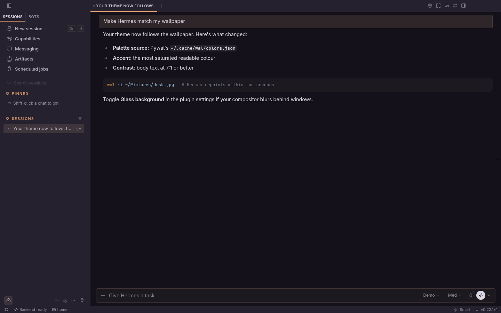
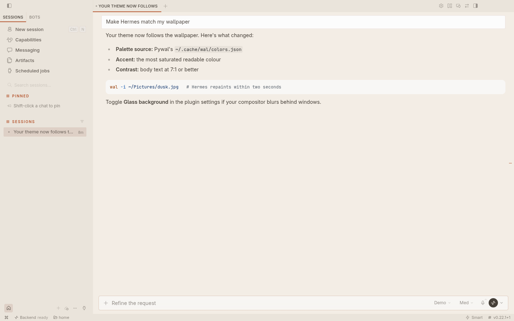
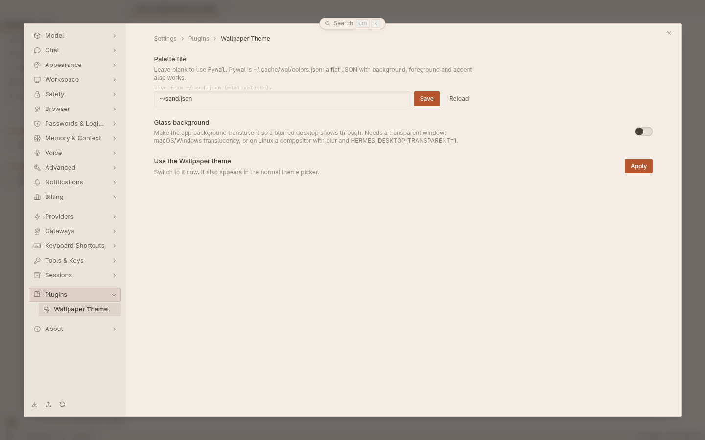
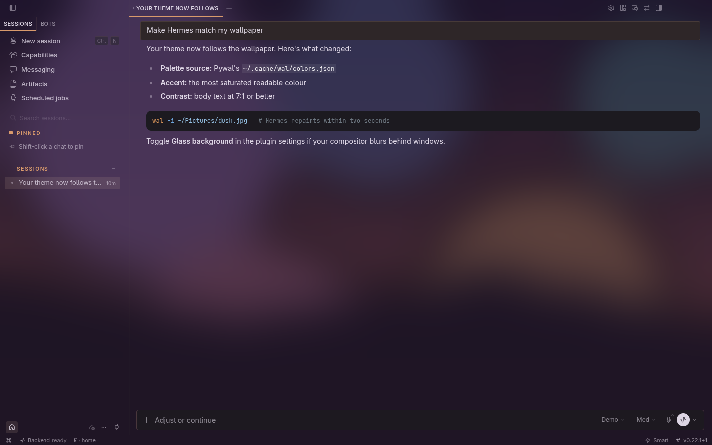

# Wallpaper Theme for Hermes Desktop

A Hermes Desktop theme that follows your wallpaper. Change the wallpaper, and Hermes repaints within a couple of seconds.

- **Works with Pywal out of the box.** It reads `~/.cache/wal/colors.json`, so there's nothing to configure.
- **Or any palette file.** Point it at a flat JSON file written by matugen, wallust, your own script, or anything else.
- **Always readable.** Wallpaper colours are adjusted until body text reaches 7:1 contrast, accents 3:1 and text on accents 4.5:1. A half-written file never repaints the app; the last good palette stays.
- **Optional glass.** The app background becomes translucent so a blurred desktop shows through.

Desktop-only: no agent tools, hooks or environment variables.

| Pywal palette (default) | Flat palette file |
|---|---|
|  |  |
| **Settings page** | **Glass at 60%** |
|  |  |

Screenshots come from a throwaway Desktop instance with sample palettes and a canned model reply. In the glass shot, the Desktop window was captured with its transparency and composited over a sample wallpaper with a 24 px Gaussian blur, standing in for compositor blur.

## Install

In Hermes Desktop: **Capabilities → Plugins → Install from Git**, paste

```
https://github.com/strnadchristopher/hermes-wallpaper-theme
```

and install. Desktop loads it within a few seconds. Choose **Wallpaper** in the theme picker, or run **Theme: use Wallpaper** from the command palette.

This is a desktop-only plugin with no agent half, so installing it this way keeps it out of your agent profiles. (`hermes plugins install` also works, but it files the plugin under one profile, and Desktop then offers **Install here** for every other profile. You can ignore that.)

To install by hand, copy `desktop/plugin.js` to `~/.hermes/desktop-plugins/hermes-wallpaper-theme/plugin.js`.

## Choosing the palette file

The plugin uses the first of these that is set:

1. **Settings → Plugins → Wallpaper Theme → Palette file.** Stored per Desktop install.
2. **`~/.config/hermes-wallpaper-theme/config.json`**, for dotfiles that set up several machines the same way:

   ```json
   { "source": "~/.local/share/wal-glass/palette.json" }
   ```

3. **Pywal:** `~/.cache/wal/colors.json`.

Paths are read on the machine running Desktop, and `~` is expanded.

## Palette formats

**Pywal** `colors.json` (`special.background`, `special.foreground`, `colors.color0`–`color15`). The accent is the most saturated readable colour; surfaces are mixed from the background and foreground.

**Flat palette**, for everything else:

```json
{
  "background": "#151817",
  "foreground": "#f5f6f8",
  "surface": "#252927",
  "accent": "#b4c3be",
  "selection_text": "#06090a"
}
```

`background` and `foreground` are required. `surface`, `accent` and `selection_text` (text on the accent) are optional and derived when missing. If you supply colours that fail the contrast floors above, they're nudged until they pass.

To use matugen or wallust, add a template that writes this shape and point the plugin at its output.

## Glass

Turn on **Glass background** in the plugin's settings and set the opacity (30–100%, default 82%). The page background becomes translucent. Raised surfaces like menus and dialogs, the terminal, and text stay solid.

What shows through depends on the window:

- **macOS and Windows:** turn on **Settings → Appearance → Translucency** so the native material is behind the page.
- **Linux:** Desktop has to create its window transparent and your compositor has to blur behind it. Start Desktop with `HERMES_DESKTOP_TRANSPARENT=1` (Hermes builds that include it) and add a blur rule. On Hyprland, for example:

  ```ini
  # hyprland.conf; class is com.nousresearch.hermes
  decoration { blur { enabled = true; size = 8; passes = 3 } }
  ```

  Without a transparent window, glass simply looks like the solid theme.

## WalGlass users

If you already generate `~/.local/share/wal-glass/palette.json`, point the plugin at it with the config file above. Its tuned `surface`, `accent` and `selection_text` are used as-is.

## Development

```bash
npm test   # node --test; stubs the SDK, no Hermes checkout needed
```

`desktop/plugin.js` is plain ESM that imports only `@hermes/plugin-sdk` and `react`. Desktop loads it as-is, with no build step.

MIT licensed.
